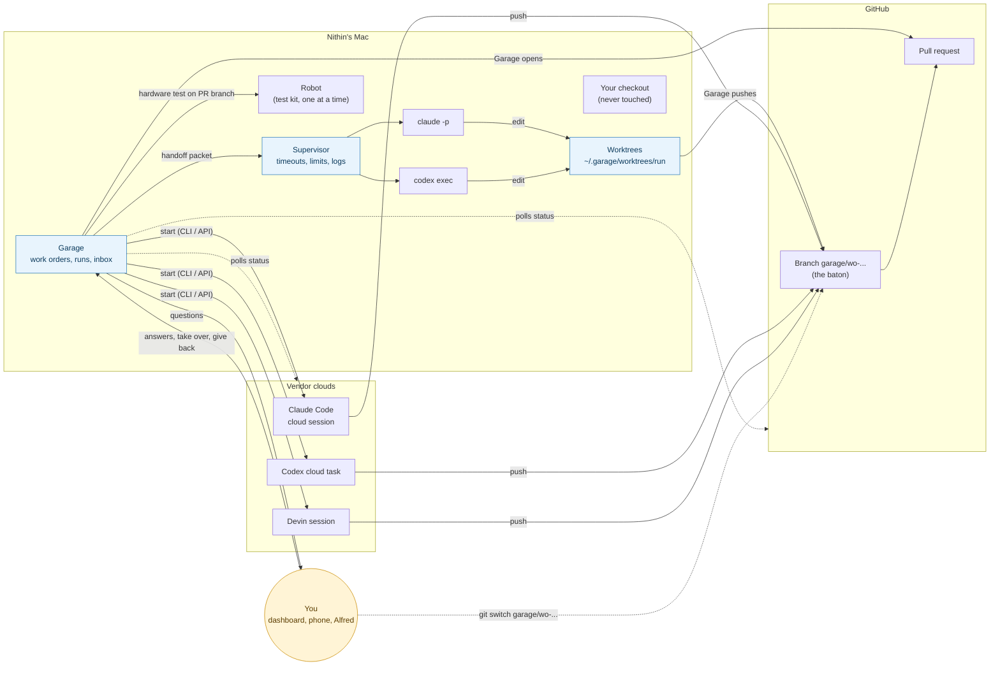

# Handing work to Claude Code and Codex, on the Mac and in the cloud

Status: **design draft for review. No code yet.** Builds on [vision.md](vision.md) (contract 4 work order,
contract 5a agent result) and stays consistent with the draft `docs/workspace-and-interface.md`
([PR #3](https://github.com/sesh11/garage/pull/3)): one API, an MCP server for every client, a "Run" noun, GitHub App.

Vendor facts were checked against official docs on 2026-11-02. Each fact is marked:
- **[tested]**: we ran it here (Ubuntu VM, not the Mac).
- **[docs]**: read in current official docs, not run.
- **[inferred]**: our reading or a design choice; check before relying on it.

There is no Anthropic key in this environment, so nothing Claude-related was run. Codex CLI 0.166.0 was run with
an OpenAI API key on a throwaway toy repo (see §8).

## Words used here

- **Agent**: a coding AI that can edit code and run commands: Devin, Claude Code, Codex.
- **Run**: one attempt by one agent on one work order (today that's a Devin session). Same word as PR #3.
- **Place**: where a run's code edits and commands happen: **local** (Nithin's Mac) or **cloud** (a vendor's machine).
- **Holder**: who is allowed to change the run's branch right now: one agent run, or a human. Never two at once.
- **Worktree**: a second checkout of the same git repo in another folder (`git worktree add`), so an agent can work
  without touching the folder you're using.
- **Headless**: run from a program with no screen or keyboard (e.g. `claude -p`, `codex exec`).
- **Supervisor**: the part of Garage that starts agent programs on the Mac, watches them, and stops them if they hang.
- **MCP** (Model Context Protocol): a standard way for an agent to call tools. Garage plans to offer its own MCP server.
- **Subscription vs API key**: a subscription is a monthly plan you sign in with (Claude Pro/Max, ChatGPT Plus/Pro);
  an API key is pay-per-use billing per token.

## 1. What a handoff means

**A handoff is Garage giving one work order to one holder, and always knowing who holds it, where it is running,
how it's going, and how to get the work back.**

Five things make it "seamless":

1. **Same packet every time.** Whatever the agent and place, Garage hands over the same work order (contract 4) and
   expects the same result back (contract 5a). The connector translates.
2. **The branch is the baton.** All real work lives on one git branch on GitHub (`garage/<work-order>`). Anything that
   moves between agents, places or people moves by pushing that branch. Chat history is a bonus, not the handoff.
3. **One holder at a time, and Garage knows who.** Every run has an owner, a place, a status and a link. Garage stops
   the old holder before the new one starts, so two writers never fight over a branch.
4. **Questions come to Garage, answers go back to the agent.** If an agent is stuck, its question shows up in Garage's
   inbox (dashboard, phone, Alfred). Your answer goes back through that agent's own "follow-up" mechanism.
5. **You can always step in.** "Take over" pauses the run, pushes the branch, and gives you one command to continue on
   your laptop. "Give back" starts a new run on the same branch with a short note of what you changed.

What Garage hands over (the **handoff packet**): the work order, the branch name and the commit to start from, a
short **handoff note** (what's done, what's left, open questions; empty on the first run), the result schema (5a),
and limits (time, cost, may-it-open-a-PR).

What comes back: status changes, questions, and at the end the 5a result plus the branch's last commit.

### Scenarios

| # | Scenario | What happens |
|---|---|---|
| A | Garage on the Mac starts a **local Claude Code run** | Garage makes a worktree on a new branch, starts `claude -p` there, reads its event stream, and when it ends pushes the branch and opens the PR itself. |
| B | Garage sends a task to **Codex cloud** | Garage pushes a base branch, starts the task (`codex cloud exec`), and polls the task list and GitHub until a diff or PR appears. Results come back without Garage needing a public URL. |
| C | A local run **moves to the cloud** (Mac going to sleep, task is long) | Garage stops the local run at a clean point, commits and pushes work-in-progress, writes the handoff note, and starts a cloud run on the same branch. |
| D | A cloud run **moves to the Mac** (needs the robot) | Garage waits for or stops the cloud run, fetches its branch, and starts a local run in a worktree. Vendor shortcuts exist: `claude --teleport`, `codex apply`. |
| E | **You pick up** an agent's in-progress work on your laptop | `garage take <run>`: Garage stops the run, pushes, marks you as holder, prints `git fetch && git switch garage/...` (or `claude --teleport <id>` / `codex resume <id>` if you want the conversation too). |
| F | An agent **gets stuck and asks you** something | The run ends its turn with a question (or raises one live, where supported). Garage puts it in the inbox as "needs info". You answer anywhere; Garage sends it back and the same run continues. |
| G | You **give it back** | `garage give-back <run> "note"`: Garage starts a new run on the same branch with your note in the handoff note. |

What a handoff does **not** promise: moving the agent's private conversation between vendors (Claude ↔ Codex).
Only the branch and the handoff note travel. [inferred]

## 2. Ways to hand work to Claude

Claude has several different products. They are named exactly here because they behave differently.

| Option | Place | How Garage starts it | Progress / status | Questions | Cancel | Results / PR | Auth and cost | Mac hardware |
|---|---|---|---|---|---|---|---|---|
| **Claude Code CLI, headless** `claude -p` | local | subprocess in a worktree: `claude -p "<task>" --output-format stream-json`; `--bare` for repeatable runs; `--json-schema`, `--max-turns`, `--max-budget-usd` exist [docs] | JSON event stream on stdout; exit code 0 / non-zero [docs] | no live human prompt in `-p`; pre-allow tools with `--allowedTools`. Ask between turns: end with a question, then `claude -r <session> -p "<answer>"` [docs + inferred] | SIGINT ends the turn cleanly; SIGTERM exits 143 and leaves the turn unfinished [docs] | edits in the worktree; Garage pushes and opens the PR [inferred] | subscription login or API key; `--bare` needs `ANTHROPIC_API_KEY` [docs]. Plan limits or per-token | **yes** (runs on the Mac) |
| **Claude Agent SDK** (Python `claude_agent_sdk`) | local | `query(prompt, options)` or `ClaudeSDKClient` from Garage's own Python [docs] | typed messages; final `ResultMessage` with cost [docs] | **live**: `can_use_tool` callback gets permission requests and `AskUserQuestion` questions [docs] | `interrupt()` [docs] | same as CLI; `output_format` gives validated JSON for 5a [docs] | **API key**. Anthropic: third-party products built on the SDK may not offer claude.ai (subscription) login [docs] | **yes** |
| **Claude Code background sessions** (`claude --bg`, `claude agents --json`, `claude logs`, `claude attach`, `claude stop`) | local | start a session in the background [docs] | `claude agents --json` lists sessions; `claude logs <id>` [docs] | you `claude attach <id>` and answer in the terminal [docs] | `claude stop <id>` [docs] | in its worktree/branch [inferred] | same as CLI | yes |
| **Remote Control** (`claude --remote-control`) | local, steered from phone | interactive session, not headless [docs] | claude.ai/code or the Claude phone app [docs] | you answer on your phone [docs] | from the app | local | **subscription only**, no API key [docs] | yes |
| **Claude Code cloud sessions** (claude.ai/code, `claude --cloud`) | cloud (Anthropic VM) | `claude --cloud "<task>"` from a checkout; clones the GitHub branch, so push first [docs] | claude.ai/code and phone app. **No documented status API**; Garage would watch GitHub for the branch/PR [inferred] | `claude -p --cloud <session-id> "<answer>"` queues a message into the session [docs]; you can also answer in the app | in the app [docs]; no CLI cancel found [inferred] | pushes a branch; PR from claude.ai/code [docs] | **subscription only**; plan limits, no separate VM charge [docs]. Needs Claude GitHub App or `/web-setup` | no |
| **Cloud → terminal** (`claude --teleport <id>`) | cloud → local | pulls a cloud session into your terminal: checks out its branch and loads the chat [docs] | — | — | — | one-way; the terminal copy doesn't sync back [docs]. The **desktop app** can send a local session to the cloud [docs] | subscription | — |
| **Self-hosted environment** (`claude self-hosted-runner`, `--environment ccpool_...`) | "cloud session" running **on your own machine** | runner on the Mac claims sessions from Anthropic's queue; outbound HTTPS only [docs] | as cloud sessions | as cloud sessions | as cloud sessions | as cloud sessions | **Team / Enterprise only, public beta** [docs] | **yes** (on the runner host) |
| **Claude Code GitHub Action** (`@claude` in issues/PRs) | GitHub runner | Garage comments `@claude ...` or dispatches a workflow [docs + inferred] | GitHub Actions run status and comments | reply on the issue with another `@claude` comment [inferred] | cancel the workflow run [inferred] | commits/PR/comments on GitHub [docs] | `ANTHROPIC_API_KEY` or `CLAUDE_CODE_OAUTH_TOKEN` (from `claude setup-token`) as a repo secret [docs] | only on a self-hosted runner on the Mac [inferred] |
| **Claude Managed Agents** (Claude API, beta) — *not Claude Code* | cloud, or a **self-hosted sandbox** on the Mac | REST: create agent, environment, session; send a user event [docs] | **SSE event stream**, full history server-side [docs] | send more user events; tool confirmations [docs] | interrupt event [docs] | GitHub repo mounted into the sandbox, PR via GitHub MCP [docs] | **API key**; tokens + $0.08 per running session-hour; hard budgets [docs] | **yes** with a self-hosted sandbox worker (outbound HTTPS only) [docs] |
| **Claude desktop app** (Code tab) | local, cloud or SSH | a human clicks; no program API found [inferred] | in the app | in the app | stop button | diffs, PR monitoring in the app [docs] | subscription [docs] | local: yes |
| `claude mcp serve` | local | exposes Claude Code's *tools* (read, edit...) to another MCP client [docs] | — | — | — | — | — | not a way to hand off a task; skip [inferred] |

Links: [headless](https://code.claude.com/docs/en/headless), [CLI reference](https://code.claude.com/docs/en/cli),
[sessions](https://code.claude.com/docs/en/sessions), [Agent SDK](https://code.claude.com/docs/en/agent-sdk/overview),
[SDK user input](https://code.claude.com/docs/en/agent-sdk/user-input),
[SDK structured output](https://code.claude.com/docs/en/agent-sdk/structured-outputs),
[cloud sessions + teleport](https://code.claude.com/docs/en/claude-code-on-the-web),
[Remote Control](https://code.claude.com/docs/en/remote-control),
[self-hosted environments](https://code.claude.com/docs/en/self-hosted-environments),
[GitHub Actions](https://code.claude.com/docs/en/github-actions), [desktop](https://code.claude.com/docs/en/desktop),
[feature availability by login](https://code.claude.com/docs/en/feature-availability),
[MCP](https://code.claude.com/docs/en/mcp), [Managed Agents](https://platform.claude.com/docs/en/managed-agents/overview),
[Managed Agents self-hosted sandboxes](https://platform.claude.com/docs/en/managed-agents/self-hosted-sandboxes),
[Managed Agents GitHub](https://platform.claude.com/docs/en/managed-agents/github),
[pricing](https://platform.claude.com/docs/en/about-claude/pricing).

**Claude Code as an MCP client** (to call Garage's MCP server): yes, `claude mcp add --transport http garage
http://127.0.0.1:8765/mcp`, or `--mcp-config` in headless runs [docs]. A cloud session can't reach a server on the
Mac's loopback address [inferred].

## 3. Ways to hand work to Codex

| Option | Place | How Garage starts it | Progress / status | Questions | Cancel | Results / PR | Auth and cost | Mac hardware |
|---|---|---|---|---|---|---|---|---|
| **Codex CLI, headless** `codex exec --json` | local | `codex exec -C <worktree> --json -s workspace-write "<task>"` [tested] | JSON Lines: `thread.started`, `turn.started`, `item.started/completed`, `turn.completed` (with token usage), `turn.failed`, `error` [tested] | no live human approval in exec [docs]. Between turns: `codex exec resume <thread_id> "<answer>"` keeps the context [tested] | SIGINT exited 1, SIGTERM killed it; neither wrote a final event [tested] | edits in the worktree; `--output-schema` + `-o` give the final 5a JSON [tested]; Garage pushes and opens the PR [inferred] | API key (`CODEX_API_KEY`, per-token) [tested] or ChatGPT login (plan limits) [docs] | **yes** (runs on the Mac; sandbox may need loosening) [inferred] |
| **Codex Python SDK** (`openai-codex`) | local | `Codex().thread_start(...)`, `thread.run(prompt)`; async version exists [docs] | typed notifications via `turn(...).stream()` [docs] | `steer()` adds input mid-turn; follow-up turns; general approval callbacks not documented in the high-level API [docs + inferred] | `interrupt()` [docs] | `output_schema=`, final response, items [docs] | API key or ChatGPT [docs] | yes |
| **Codex TypeScript SDK** (`@openai/codex-sdk`) | local | wraps `codex exec` [docs] | streamed events [docs] | follow-up turns [docs] | AbortSignal [docs] | same as exec | same | yes |
| **Codex app-server** (`codex app-server`, JSON-RPC over stdio) | local | `thread/start`, `turn/start` [docs] | `item/*`, `turn/completed`, `turn/diff/updated` notifications [docs] | **live**: approval requests with IDs (`accept` / `decline`), user-input requests, MCP elicitation [docs] | `turn/interrupt` → status `interrupted` [docs] | diff notifications; no PR [docs] | API key or ChatGPT [docs] | yes |
| `codex mcp-server` | — | **removed** [docs + tested: the command no longer works] | | | | | | |
| **Codex cloud via CLI** (`codex cloud exec`, experimental) | cloud (OpenAI) | `codex cloud exec --env <ENV_ID> --branch <b> "<task>"` [docs; help output tested, no task submitted] | `codex cloud list --json` (id, url, status, summary) and `codex cloud status <id>` [docs] | no CLI command to answer; you answer in the task page [docs + inferred] | no CLI cancel [tested help]; cancel in the web UI [inferred] | `codex cloud diff <id>`, `codex apply <id>` applies the diff locally; web UI can open a PR [docs] | **ChatGPT login only**, plan usage limits; API key alone doesn't give cloud [docs] | no |
| **Codex cloud via web / IDE / desktop** | cloud | a human starts it; IDE and desktop can delegate to cloud [docs] | in the UI | follow-ups in the UI [docs] | in the UI | PR from the UI [docs] | ChatGPT login | no |
| **`@codex` on GitHub** | cloud | comment on a **pull request** (`@codex review`, `@codex fix the CI failures`) [docs]; issue triggers not documented [inferred] | GitHub reactions, comments, reviews | reply on the PR [inferred] | — | pushes fixes / reviews on the PR [docs] | ChatGPT plan + connected repo [docs] | no |
| **Codex GitHub Action** (`openai/codex-action@v1`) | GitHub runner | workflow runs `codex exec` with a prompt [docs] | Actions run status; `final-message` output [docs] | rerun the workflow with the answer [inferred] | cancel the workflow [inferred] | edits on the runner; a later step must push/open a PR [docs] | API key secret, per-token [docs] | only on a self-hosted runner on the Mac [inferred] |
| **Local computer access with Work Cloud** | cloud brain, runs tools on a connected desktop | enterprise feature, admin enabled [docs] | in the app | in the app | in the app | — | enterprise ChatGPT [docs] | partly; not general USB access [inferred] |

Links: [non-interactive mode](https://developers.openai.com/codex/non-interactive-mode),
[commands incl. cloud](https://developers.openai.com/codex/developer-commands), [SDK](https://developers.openai.com/codex/codex-sdk),
[Python SDK API](https://github.com/openai/codex/blob/main/sdk/python/docs/api-reference.md),
[app-server](https://developers.openai.com/codex/app-server), [cloud](https://developers.openai.com/codex/cloud),
[cloud environments](https://developers.openai.com/codex/environments/cloud-environments),
[GitHub](https://developers.openai.com/codex/third-party/github), [GitHub Action](https://developers.openai.com/codex/github-action),
[auth](https://developers.openai.com/codex/auth), [pricing](https://developers.openai.com/codex/pricing),
[MCP](https://developers.openai.com/codex/extend/mcp), [IDE](https://developers.openai.com/codex/ide),
[Work Cloud local access](https://developers.openai.com/codex/enterprise/cloud-local-access).

**Codex as an MCP client**: yes, `[mcp_servers.garage] url = "http://127.0.0.1:8765/mcp"` in `config.toml` [docs].
Its tool calls show up as items in the event stream [docs]. A cloud task can't reach the Mac's loopback [inferred].

### The short version

| | Local, scriptable today | Live questions | Cloud, scriptable today | Cloud status for a program | Mac hardware |
|---|---|---|---|---|---|
| Claude | `claude -p` (or Agent SDK) | Agent SDK `can_use_tool` | `claude --cloud` (subscription) or Managed Agents API (API key) | watch GitHub; Managed Agents has a real event stream | local, self-hosted runner, or Managed Agents self-hosted sandbox |
| Codex | `codex exec --json` [tested] (or Python SDK) | app-server | `codex cloud exec` (experimental, ChatGPT login) | `codex cloud list --json` | local only |
| Devin (today) | — | session messages | Devin API | Devin API | child session on the Mac |

## 4. Desktop vs cloud

**Local runs need Garage to bring the computer.** The CLI agents only edit files and run commands; they don't
check out, push, open PRs or clean up. On the Mac, Garage supplies:

- **A worktree per run**, under `~/.garage/worktrees/<run>`, on branch `garage/<work-order>` from the manifest's
  `dispatch.base_branch`. Your always-on checkout is never touched; Garage refuses to run an agent in it.
- **Credentials**: the agent's own login (whatever `claude` / `codex` is signed in with) or an API key Garage
  passes only to that process. GitHub push and PR creation are done **by Garage** (its GitHub App from PR #3, or
  `gh` for now), so agents never get GitHub write tokens.
- **A supervisor**: starts each agent as its own process group, saves its event stream to
  `~/.garage/runs/<run>/events.jsonl`, maps events to status, enforces a **wall-clock timeout** and an **idle
  timeout** (no events for N minutes), and a **cost cap** where the agent supports one (`--max-budget-usd`).
  On stop: SIGINT first (Claude ends the turn cleanly), then SIGTERM, then kill the group.
- **Concurrency limits**: e.g. 2 local runs at once, and **one run at a time per hardware device** (the robot is a
  shared lock). Extra work waits in a queue.
- **Restart recovery**: the run record keeps the agent's session/thread ID, worktree and last commit. If Garage or
  the Mac restarts, a run whose process is gone is marked "interrupted" and can be resumed by ID.
- **Sleep**: local runs stop when the Mac sleeps. Garage keeps the Mac awake while runs are active (`caffeinate`)
  or moves long ones to the cloud (scenario C) [inferred].
- **Sandboxing**: start with the agent's own sandbox (`codex -s workspace-write`, Claude `--allowedTools`) in the
  worktree. Hardware tests may need more access; those should be run **by Garage as the test kit** after the agent
  finishes, not by the agent itself.

**Cloud runs bring their own computer** but need:

- **GitHub access for the vendor**: the Claude GitHub App or `/web-setup` for Claude cloud; a connected repo and a
  published environment for Codex cloud. Garage pushes the base branch first, because cloud runs clone from GitHub.
- **A way back without a public URL**: Garage on the Mac can't receive webhooks. So Garage **polls**: GitHub
  (new commits on the run's branch, new PRs, comments) plus the vendor's list where one exists (`codex cloud list
  --json`; Managed Agents event stream, which is an outbound connection). Same choice as PR #3 §3 option A.
- **Questions from cloud runs** reach you through the vendor's app first. Garage can only see them where the vendor
  exposes them (Managed Agents events; maybe not Claude cloud sessions or Codex cloud) [inferred]. Garage shows
  "needs you: open link" with the task URL as a fallback.
- **No hardware**: cloud runs can't touch the robot. Garage runs the hardware test kit locally on the PR branch
  afterwards (the outpost step), or the run moves to the Mac (scenario D).

## 5. Proposed connector interface (sketch)

One interface for every agent and place. Today's `CodingAgent` (`create_session` / `get_session` / `map_status`)
becomes the Devin implementation of it.

```python
class Place(StrEnum):
    local = "local"      # Garage supplies the worktree and pushes
    cloud = "cloud"      # vendor's machine; vendor pushes or returns a diff


class Capabilities(BaseModel):
    places: set[Place]
    questions: Literal["live", "between_turns", "in_vendor_app"]
    opens_pr: bool            # the agent opens PRs itself (Devin, cloud); else Garage does
    can_cancel: bool
    can_resume: bool          # follow-up turns on the same conversation
    hardware: bool            # can reach this machine's devices
    cost_model: Literal["subscription", "per_token", "per_session_hour", "acu"]


class Handoff(BaseModel):     # what Garage hands over
    work_order: WorkOrder     # contract 4
    branch: str               # garage/<work-order>
    base_sha: str
    note: str = ""            # what's done / left / asked, from the previous holder
    result_schema: dict       # contract 5a
    limits: Limits            # timeout, idle timeout, max cost


class RunStatus(BaseModel):
    state: Literal["starting", "working", "needs_input", "finished", "failed", "cancelled", "expired"]
    question: str | None      # set when needs_input
    url: str | None           # vendor link, if any
    cost: Cost | None


class AgentConnector(Protocol):
    name: str                                   # "devin", "claude-code", "codex"
    capabilities: Capabilities

    async def start(self, handoff: Handoff, place: Place, workdir: Path | None) -> RunRef: ...
    async def status(self, run: RunRef) -> RunStatus: ...
    def events(self, run: RunRef) -> AsyncIterator[RunEvent]: ...   # optional live stream
    async def send(self, run: RunRef, text: str) -> None: ...        # answer a question / steer
    async def cancel(self, run: RunRef) -> None: ...
    async def result(self, run: RunRef) -> AgentResult: ...          # contract 5a + branch + head_sha
    def resume_hint(self, run: RunRef) -> str | None: ...            # e.g. "claude --teleport <id>"
```

How each fits (first versions):

| Connector | `start` | `status` / `events` | `send` | `cancel` | `result` |
|---|---|---|---|---|---|
| Devin (today) | `create_session` | `get_session` + `map_status` | session message | stop session | structured output + PR |
| Claude Code, local | `claude -p --output-format stream-json --json-schema ...` in the worktree | the stream | `claude -r <id> -p "<text>"` | SIGINT → SIGTERM | `--json-schema` result; Garage pushes + opens PR |
| Codex, local | `codex exec --json --output-schema ...` in the worktree | the JSONL | `codex exec resume <thread> "<text>"` | SIGINT → SIGTERM | `-o` file; Garage pushes + opens PR |
| Claude Code, cloud | `claude --cloud "<task>"` | GitHub branch/PR polling | `claude -p --cloud <id> "<text>"` | not scriptable (link) | PR or branch |
| Codex, cloud | `codex cloud exec --env ... --branch ...` | `codex cloud list --json` | not scriptable (link) | not scriptable (link) | `codex cloud diff`; Garage applies, pushes, opens PR |

**Mapping to the contracts.** The connector turns the work order (contract 4) plus the handoff note into the agent's
prompt, and the 5a schema into `--json-schema` / `--output-schema` / Devin structured output. 5a gains a few
fields so every agent reports the same thing:

```json
{"work_order": "wo-ambient-home-42-1", "summary": "...", "pr_url": "https://...", "test_result": "passed",
 "risk": "low", "branch": "garage/wo-ambient-home-42-1", "head_sha": "1a2b3c4",
 "question": null, "agent": "codex", "place": "local", "cost": {"kind": "per_token", "usd": 0.21}}
```

A non-null `question` means "I stopped to ask"; Garage moves the item to `needs_info` (PR #3 state) and keeps the
run resumable. This is how between-turn questions work for every agent, even ones with no live question support.
`needs_input` maps to today's `SessionStatus.blocked`.

**MCP, optional on top.** Garage's MCP server (PR #3 phase 5) can add `garage_ask(run, question)` and
`garage_report(run, note)` for local runs. Useful, but the event stream stays the source of truth, because an agent
may crash before it calls a tool [inferred].

## 6. Picture



## 7. Recommendation and plan

**Build first: local runs for both Codex and Claude Code through one local runner**, with between-turn questions
and "take over / give back". Reasons:
- Both CLIs are scriptable today with stable, documented event streams; Codex was tested end to end here.
- It's the only path that reaches the robot without enterprise features.
- The hard part (worktree, supervisor, push, PR, questions) is shared, so the second agent is cheap.
- Cloud options are weaker for a program: Claude Code cloud has no status API and needs a subscription; Codex
  cloud CLI is experimental and has no cancel or answer command. Start them after local works, tracked through GitHub.

Use the **CLIs, not the SDKs, first**: same tool you'd run by hand, works with your own login, and Garage doesn't
take on the Agent SDK's API-key-only rule. Move to the Agent SDK / Codex app-server later only if we want live
approvals in the Garage UI.

**Phases** (each usable on its own):

1. **Connector interface + Run record**: wrap today's Devin client in `AgentConnector`; add `agent`/`place` to the
   manifest's dispatch section (default `devin`). No behavior change. Tests with fakes.
2. **Local runner + Codex connector**: worktrees, supervisor (timeouts, idle, concurrency, process groups), event
   log, push and PR by Garage, 5a via `--output-schema`.
3. **Claude Code connector** on the same runner (`claude -p --output-format stream-json --json-schema`).
4. **Questions and human takeover**: `question` in 5a → `needs_info` → answer → resume; `garage take` /
   `garage give-back`; robot lock and the hardware test kit run by Garage after the agent.
5. **Cloud connectors**: Codex cloud (`codex cloud exec`, poll `list --json`, apply diff) and Claude Code cloud
   (`claude --cloud`, poll GitHub); local ↔ cloud moves via the branch (scenarios C, D).
6. **Live questions and MCP**: Garage MCP tools for local runs; optionally Agent SDK / app-server for live approvals;
   optionally Claude Managed Agents if we want a cloud Claude with a real API.

## 8. What was tested

On an Ubuntu VM with Codex CLI 0.166.0 and an OpenAI API key, on a throwaway toy repo with a bug and a unit test:
- `codex exec --json -s workspace-write` fixed the bug and ran the test; events seen: `thread.started`,
  `turn.started`, `item.started`, `item.completed` (`file_change`, `command_execution`, `agent_message`),
  `turn.completed` with token usage; failures came as `error` + `turn.failed` (a model we lacked access to).
- `codex exec resume <thread_id> "..."` continued the same thread with its context.
- `--output-schema` + `-o` produced exactly the schema-shaped JSON.
- SIGINT (exit 1) and SIGTERM both stopped a run mid-command with no final event; the child `sleep` was gone.
- `codex mcp-server` no longer works; `codex app-server --help` and `codex cloud --help` exist (`exec`, `status`,
  `list`, `diff`, `apply`; no cancel).

Not tested: anything Claude (no key), Codex SDKs, app-server sessions, Codex cloud tasks, GitHub triggers,
desktop apps, macOS, hardware.

## 9. Open questions

1. **Logins and billing**: run local agents on your subscriptions (Claude Pro/Max, ChatGPT plan) or API keys
   (pay per use)? Cloud sessions for both vendors need the subscription login.
2. **Which plans do you have?** Claude Team/Enterprise unlocks self-hosted runners (cloud sessions on the Mac);
   ChatGPT plan decides Codex cloud access.
3. **Who opens PRs for local runs**: Garage (recommended: one place for tokens and labels) or the agent via `gh`?
4. **Questions**: is "agent stops and asks, you answer, it continues" enough for now, or do you want live
   approvals (agent waits mid-step for your yes/no)?
5. Is a pay-per-use cloud Claude (Managed Agents API) in scope, or stick with Claude Code?
6. Default concurrency on the Mac (suggest 2) and timeouts (suggest 60 min wall, 10 min idle).
