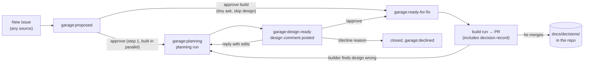

# The PM and design step, and how Garage remembers design decisions

Status: **design draft for review. No code yet.** Builds on [vision.md](vision.md) (contract 3, the PM step) and
the workspace design in draft PR #3 (`docs/workspace-and-interface.md`: nouns, approval modes).
Slots in after the approval step being built in parallel (new issues land as *proposed*; Nithin approves them with a
GitHub label, the dashboard, or `garage approve`) and before dispatch, per project (PR #14).

## 0. The short version

1. **Garage still runs no LLM of its own.** After Nithin approves an issue, Garage starts a *planning run*: a short,
   read-only job on the same coding agents it already uses for fixes (Claude Code, Codex, Devin), with a hard cost cap.
   The agent returns the design as structured data; Garage checks it and posts it on the issue.
2. **The design is one comment on the issue** with a fixed shape: the need, options, recommendation, in/out of scope,
   how we'll know it works, and which past decisions it relies on or changes.
3. **He approves from his phone** by replying on the issue in the GitHub app: `/approve`, `/approve B`, any other
   reply = "revise with this", or `/decline <reason>`. The dashboard and `garage approve` do the same.
4. **Memory lives in the project's own repo**: `docs/product.md` (the product brief) and `docs/decisions/` (one short
   file per lasting decision). Versioned, reviewed in PRs, readable by any agent without Garage.
5. **Garage keeps the index and the in-between states** in its database: item → issue → design revisions → approval →
   decision record → PR, including declined designs and decisions approved but not yet merged. Everything in it can
   be rebuilt from GitHub and the repo, except run costs.
6. **Garage is the first project**: this PR seeds `docs/product.md` and `docs/decisions/` for Garage itself.

## Words used here

- **Product brief**: `docs/product.md` in a project's repo: what the product is for, who it is for, principles,
  what it will not do (non-goals), and the current focus. The manifest already points at it (`product_brief`).
- **Design**: a short written proposal for how to do one approved ask, posted on its issue before any code.
  (vision.md calls this the *plan*; same thing.)
- **Decision record**: a small Markdown file that writes down one decision: the question, the options, what was
  chosen, why, and the date. Software teams call these ADRs (architecture decision records); ours also cover product
  decisions.
- **Planning run**: one run of a coding agent whose only job is to read the repo and its memory and return a design.
  It may not change code.
- **Build run**: today's dispatch: a coding agent that writes the code and opens a PR.
- **Revision**: a new version of a design after Nithin asks for changes. Every revision stays on the issue.
- **Context pack**: the bundle of memory Garage hands an agent: brief, decision index, related records, and anything
  in flight.
- **Front matter**: a few `key: value` lines at the top of a Markdown file between `---` lines, so programs can read
  fields (status, date) without parsing the prose.
- **Supersede**: a newer decision replaces an older one. The old file stays, marked `superseded`.

## 1. Where this sits in the loop



Two approval points per ask, matching `[policy].needs_approval = ["triage", "plan", "release"]`:
**approve the ask** (triage, being built now) and **approve the design** (plan, this doc). Release stays separate.
For tiny asks, approving with "build" at step 1 counts as approving the ask *as its own plan*: no planning run, no
decision record. Only Nithin makes that call; the planner never skips itself.

Labels use the `garage:` names from the approval-step PR (#23), which keeps the old `factory:` names readable on
existing issues. New here: `garage:planning`, `garage:design-ready`, `garage:declined`. `garage:ready-for-fix`
now means "design approved (or skipped)", which is what dispatch already waits for, so dispatch does not change.

## 2. Who runs the PM and design step

### Options

| | A. Garage calls a model itself | B. The assistant that filed the ask writes the design | C. A planning run on the user's coding agent (recommended) |
|---|---|---|---|
| What happens | Garage holds an API key and calls Claude/GPT | Alfred or a Claude Code chat drafts the design while talking to him | Garage starts a read-only run on Claude Code, Codex or Devin |
| Fits "no LLM in Garage" | no | yes | yes: the model lives in the agent the user already set up |
| Sees the code and decisions | only what Garage pastes in | often not (a voice assistant has no checkout) | yes: it runs in a checkout and can open any file |
| Works for incidents and GitHub issues | yes | no (nobody is chatting) | yes |
| Cost control | Garage meters tokens | the assistant's own | agent's own cap: `--max-budget-usd`, ACU limit, timeout |

**Recommendation: C, and also accept B as a shortcut.** If a client submits an ask with a draft design attached
(he is already discussing it with Claude Code), Garage validates it and posts it as revision 1, marked "drafted by
claude-code", and it goes through the same approval. Otherwise Garage starts a planning run.

This extends the routing decision ("Garage runs no LLM for routing") into a general rule: *Garage holds no model keys
and calls no model; all model work happens in agents the user configured.* That is recorded as a proposed decision
in this PR and is open question 1.

### How a planning run works

- **When**: as soon as an issue is approved at step 1 and its project has planning on. One planning run per item at
  a time; per-project concurrency is shared with build runs (`policy.max_concurrent`).
- **Where**: the project's configured planner, defaulting to its build agent. Local runs use a fresh worktree at the
  base branch (like today's local runner), so nothing touches the checkout Garage itself runs from.
- **Read-only**: the planner gets no push rights and no GitHub token; Garage, not the agent, posts the comment.
  - Claude Code: `claude -p` with `--allowedTools` limited to reading (`Read`, `Grep`, `Glob`), `--max-turns`,
    `--max-budget-usd`, and `--json-schema` for the output (flags from Claude Code docs, listed in
    [agents-claude-codex.md](agents-claude-codex.md); not yet tried in a planning run).
  - Codex: `codex exec -s read-only --output-schema design.schema.json -o design.json` plus Garage's timeout. Codex
    has no cost cap flag that we know of, so the cap is time (and the user's plan limits).
  - Devin: a session with a low `max_acu_limit`, structured output, and "do not open a PR". Devin cannot be made
    read-only, so Garage ignores and comments on any PR a planning session opens.
- **Output**: JSON matching a `Design` schema (section 3). Garage validates it (2–3 options unless marked trivial,
  every cited decision exists, acceptance criteria present) and rejects a malformed result instead of posting it.
- **Cost limits** (proposed starting values, to tune after the first ten runs):

  ```toml
  [plan]                        # in garage.toml or the project's [[project]] entry
  agent = "claude-code"         # devin | claude-code | codex; default = the build agent
  max_cost_usd = 1.00           # Claude Code --max-budget-usd
  max_acu = 1                   # Devin
  timeout = "15m"               # all agents
  max_revisions = 3             # after this, stop re-planning and ask him
  stale_after = "14d"           # see section 9
  ```

  Plus a workspace-wide daily planning budget; when it is used up, approved items wait in `garage:planning` with a
  comment saying why. Each run's cost is stored with the design and shown on the dashboard.

## 3. What gets posted on the issue

One comment per revision. Garage writes it from the planner's JSON, so every design looks the same. Short on top so
it reads on a phone; details below. Example (ambient-home, made up):

````markdown
<!-- garage-design id=d-41 rev=1 base=8bc8ef5 -->
### Design for #41 (revision 1)

**Need:** Alfred stops hearing me after the Mac wakes from sleep.
**Recommend:** B, restart the audio stream on wake. Small change, medium risk (touches the mic).
**Records a decision:** "The hub restarts audio on wake rather than rebooting the mic board."

#### Options
| | Option | Good | Bad | Size |
|---|---|---|---|---|
| A | Reboot the mic board on silence | already exists as a fallback | 8 s of deafness, hides the cause | S |
| **B** | **Restart the audio stream on wake** | **fixes the cause the logs point to** | **needs a wake hook on macOS** | **S** |
| C | Both | belt and braces | more code to test | M |

#### Scope
- In: wake detection, stream restart, an event when it happens.
- Out: changing the mic hardware; Linux.

#### How we'll know it works
- No `mic.silent_stream` events on the new version for 24 h.
- Robot test passes.

#### Fits the product brief
Core reliability; matches current focus "Alfred is always listening".

#### Past decisions
- Relies on: `2026-10-20-xmos-reboot-fallback` (linked to the file on the base branch)
- Changes: none

#### Questions for you
- none

<details><summary>Machine-readable</summary>

```json
{"id": "d-41", "rev": 1, "options": ["..."], "chosen": "B", "...": "..."}
```
</details>

Reply `/approve`, `/approve A` (pick another option), `/decline <reason>`, or just write what to change.
````

Rules:
- The hidden marker (`<!-- garage-design ... -->`) lets Garage find its own comments; `base` is the commit the
  planner read, used for the staleness check.
- "Changes" lists any accepted decision this design would supersede. If it is not empty, the summary line says
  **"Changes a past decision"** in bold so he cannot miss it.
- "Records a decision" is one sentence, or "none" for designs that make no lasting choice (most bug fixes).
- If the planner has questions it cannot answer from the repo, it says so and recommends nothing; Garage moves the
  issue to `garage:needs-info` instead of `design-ready`.

## 4. Approving and editing from the phone

The GitHub mobile app is the phone client: he gets a notification for the design comment and replies inline.

| He replies | Garage does |
|---|---|
| `/approve` | approves this revision with the recommended option; label → `garage:ready-for-fix` |
| `/approve B` | approves with option B instead (the record says he overrode the recommendation) |
| `/approve no-record` or `/approve record` | turns the decision record off or on |
| any other text | treats it as edits: starts a new planning run with his reply as input, posts revision 2 |
| `/decline <reason>` | closes the issue with `garage:declined`; reason kept (section 7) |
| `/answer <text>` | answers the planner's questions (from `needs-info`), then re-plans |

- **Edits in place also work**: he can edit the design comment's text on GitHub and then reply `/approve`. Garage
  approves the comment *as it reads at that moment* and stores a copy of that exact text, so a later edit cannot
  silently change what was approved.
- **Only approvers count.** By default that is the workspace owner's GitHub account; other people's `/approve` gets
  a polite "only the maintainer can approve" reply. Same for the dashboard and CLI (`garage approve d-41`,
  `garage approve d-41 --option B`, `garage decline d-41 --reason ...`). Later, Alfred can read out the summary line
  and relay "approve" under the `relay` mode from PR #3.
- **First decision wins.** If he approves on GitHub and declines on the dashboard a minute later, the second one is
  refused with a note saying what already happened.
- Garage reads replies by polling the issue, as dispatch already does; no webhooks needed on the Mac.

## 5. The decision record

### File layout (in each project's repo)

```
docs/
  product.md                         product brief
  decisions/
    README.md                        how to write one + the index (generated, one line per decision)
    2026-11-01-no-llm-routing.md     one file per decision: date + short name
    2026-11-08-design-memory-in-repo.md
```

File names are `YYYY-MM-DD-short-name.md` instead of numbers (`0007-...`), so two agents working in parallel can
never pick the same number, and a human can add one by hand without asking Garage. The file name (without `.md`) is
the decision's id.

### Format

```markdown
---
status: accepted            # proposed | accepted | superseded | rejected
date: 2026-11-01
decided_by: sesh11
scope: project              # project | workspace (applies to all projects)
areas: [routing, api]       # free words or paths; used to find related decisions
issue: https://github.com/sesh11/garage/issues/NN     # optional
design: https://github.com/sesh11/garage/issues/NN#issuecomment-...   # optional
pr: https://github.com/sesh11/garage/pull/NN          # optional
supersedes: []
superseded_by: null
---
# Garage runs no LLM of its own for routing

## Question
How does Garage decide which repo an ask belongs to?

## Options considered
- Garage calls a model to classify the ask.
- The assistant the person is talking to picks from Garage's repo catalog.
- Always ask the human.

## Decision
The assistant the person is talking to picks; Garage asks the human when it is unsure.

## Why
That assistant already understands the ask; Garage stays free of model keys and costs.

## What this rules out / revisit when
Garage-side classification. Revisit if most asks arrive with no assistant attached (e.g. raw GitHub issues).
```

Under ~40 lines. The planner writes the first draft inside its design; Garage turns the approved design into the file
(the builder does not write it, so the reasons are the ones he approved).

### Which designs produce a record

Not every ask is a decision. A bug fix that restarts a stream is not something future work must respect; "we never
send audio to the cloud" is. The planner proposes "records a decision: …" or "none", and he can flip it with
`/approve record` / `/approve no-record`. The design itself is always kept on the issue and in Garage's index either
way.

### When the record enters the repo

| | A. In the build PR (starting proposal, recommended) | B. A separate docs PR right after approval |
|---|---|---|
| Review work | none extra: reviewed with the code | one more PR per decision |
| Matches reality | yes: the decision lands with the code that makes it true | the record can land for code that never ships |
| Gap | days between approval and merge | none |

**Recommendation: A, with the gap closed by Garage.** At approval Garage writes the record into its database as
*approved, not yet merged* and puts it in every planner's context pack from that moment (section 6). The work order
carries the exact file; the builder adds it unchanged and may only add a short "Built" note at the end. Before
marking the run done, Garage checks the PR's file list includes the record and comments on the PR if it is missing.
After he merges, Garage re-reads the merged file (his review edits win) and marks it *in the repo*. If the PR is
closed unmerged, the decision becomes *abandoned* in Garage and stops binding future designs.

## 6. Feeding memory to planner and builder as it grows

The planner runs inside a checkout, so it can open any file itself. Garage does not need search infrastructure; it
needs to hand over a small, always-current starting point and tell the agent where to look.

**Planner context pack** (in this order, each with a size limit):
1. The issue text (marked as untrusted if it came from a stranger) and any earlier design revisions + his replies.
2. `docs/product.md`, in full. If it grows past ~2 pages, the planner is told so and flags it for trimming.
3. The decision index from `docs/decisions/README.md`: one line per *current* decision (accepted, not superseded):
   id, title, areas. At 150 characters a line, 200 decisions is about 30 KB; superseded and rejected ones drop out
   of the index but stay in the folder.
4. The full text of decisions whose `areas` overlap the paths or words of this ask (Garage matches; capped at ~10).
   Instruction: "open any other record from the index you think is relevant; cite every one you rely on".
5. From Garage's database (not in the repo yet): decisions approved but not merged, other designs currently in
   flight in this project, and declined designs whose words overlap this ask, with the decline reason.
6. Workspace decisions (scope `workspace`), section 8.

**Builder context pack**: the approved design text (verbatim), the decision record it must add, and the full text of
the decisions the design cites. Not the whole history: the design already distilled what matters, and a smaller
prompt keeps the builder on the plan. Today's dispatch prompt gains a line: "read `docs/product.md` and
`docs/decisions/README.md` before changing behavior".

When an index gets too big for this to work (hundreds of current decisions), the next step is better matching inside
Garage (still no model: keyword and path overlap, then maybe local embeddings). That is later, not now.

## 7. Declined designs

- `/decline <reason>` closes the issue with `garage:declined` and his reason in the closing comment, so the memory
  is public and searchable on GitHub without Garage.
- Garage stores the declined design and reason in its database and feeds overlapping ones to future planners
  ("this was declined on 2026-11-20 because …").
- If the reason is a **product rule** ("we won't do purchases by voice"), the planner proposes it as a `rejected`
  decision record or a new non-goal line in `docs/product.md`. Garage batches these into one rolling docs PR per
  project ("Memory updates") that he merges when convenient, so a no that matters outlives Garage's database.
- Designs he revised are also kept: every revision stays on the issue; Garage stores which one was approved.

## 8. What Garage stores vs what lives in the repo

| Thing | Repo | GitHub issue | Garage database |
|---|---|---|---|
| Product brief | `docs/product.md` | | path + last commit read |
| Accepted decisions | `docs/decisions/*.md` | | index: id, status, areas, PR, merged commit |
| Approved, not merged | (in the build PR) | | full record, status *approved* |
| Rejected product rules | `rejected` records via the Memory PR | | index |
| Design revisions | | one comment each | parsed copy, base commit, planner, cost |
| Approvals / declines | | the reply comments | who, via which client, when, which revision (exact text) |
| Links | | | item → issue → design → approval → record → PR |
| Planning run cost and logs | | | yes (only here) |

Rule: **the database is an index, not the only copy.** If it is lost, `garage memory rebuild` re-reads the repo's
decisions and the issues' marked comments. Only run costs and logs would be gone.

**Workspace-wide decisions** ("all my projects use uv", "PRs are never merged without me") apply to every project.
The starting proposal put them in Garage's repo. That works for Nithin today, but Garage is open source: other users
should not inherit his personal rules, and Garage's repo should hold decisions about *Garage the product*. Proposal:
a workspace setting `decisions_repo = "owner/repo"` naming one repo whose `docs/decisions/` records with
`scope: workspace` are fed to every project's planner. For Nithin, a small private repo (open question 3).

## 9. Failure cases

| Case | What happens |
|---|---|
| **Planner misread the ask** | He replies with what's wrong; revision 2. After `max_revisions` Garage stops re-planning, labels `garage:needs-info`, and asks him to write the need in his own words. |
| **Planning run fails** (timeout, over budget, bad JSON) | Retried once; then a one-line comment "planning failed: over budget" and the issue stays in `garage:planning` for him to retry (`garage plan d-41`) or approve as a build. |
| **Builder finds the design wrong** | The work order already says "stop and report instead of improvising". Garage moves the issue back to `garage:planning`, posts the builder's finding, and re-plans with it. No decision record lands. |
| **Design goes stale** | Before dispatch, and for any approved design older than `stale_after`, Garage checks whether files in the design's areas changed since its `base` commit or a new decision in those areas was accepted. If so it runs a cheap re-check that either confirms ("still valid") or posts a revision for approval. Stale designs are never dispatched silently. |
| **Design conflicts with a past decision** | The planner must list it under "Changes". Garage also checks mechanically: if a cited or overlapping decision says the opposite and "Changes" is empty, the design is sent back once. Approving a design that changes a decision approves the supersession. |
| **Two in-flight designs conflict** | Garage sees overlapping areas between approved-not-built designs and notes it on the newer one's card; the newer planner is given the older design. |
| **Superseding a decision** | The new record has `supersedes: [old-id]`; the build PR also flips the old file to `status: superseded`, `superseded_by: new-id`. Old files are never deleted. |
| **Hostile issue text** (prompt injection) | Only approved issues get a planning run; stranger text is quoted as untrusted; the planner is read-only and has no GitHub token. |
| **PR closed unmerged** | Decision marked *abandoned* in Garage; it stops binding planners; the issue goes back to *proposed* or closes, his choice. |

## 10. Garage as the first project

- This PR adds `docs/product.md` for Garage (filled from vision.md, with TODOs for what only he can say) and
  `docs/decisions/` with records for decisions already made, backfilled from PRs and earlier sessions.
- PR #13's `garage.toml` gains `product_brief = "docs/product.md"`.
- Designs for Garage features (like this one) go through the same flow once it exists. Until then, design PRs like
  this one add their own record with `status: proposed`, flipped to `accepted` when he merges.

## 11. Build order

Each PR is usable on its own. Code PRs keep `packages/garage-sdk/src` changes additive (ambient-home pins it).

1. **Memory files + `garage decisions`** (usable alone). `garage decisions index` writes the index into
   `docs/decisions/README.md`; `garage decisions check` validates front matter, ids, and supersede links, run in CI.
   Dispatch prompts gain "read the product brief and decision index first". Records are written by hand or by any
   agent until the rest exists. Seed ambient-home's `docs/decisions/` too.
2. **Design schema + post + approve.** `Design` and `DecisionRecord` models in the SDK; Garage renders the comment;
   `/approve`, `/approve B`, edit replies, `/decline` parsed from issue comments (needs the approval step);
   `garage design post ITEM --file design.json` and a `design` field on `/v1/items` for the shortcut in section 2.
   Usable alone: he or a Claude Code chat drafts designs; approval moves issues to `garage:ready-for-fix`.
3. **Planning runs.** Read-only runs on Claude Code and Codex (local) and Devin; context pack; cost caps and daily
   budget; retries and failure comments.
4. **Design → build → memory.** Work order carries the approved design and record; PR file check; post-merge sync;
   supersede handling; *approved, not merged* and *abandoned* states.
5. **Staleness, conflicts, declines.** Stale re-check, conflict detection, declined-design memory, the rolling
   Memory PR, `garage memory rebuild`.
6. **Later:** periodic backlog review (themes, retire stale asks, propose "current focus" changes), Alfred reading
   designs aloud and relaying approvals, a dashboard design view, workspace `decisions_repo`.

## 12. Open questions for Nithin

1. **Extend "no LLM in Garage" from routing to everything** (Garage holds no model keys; all model work runs in
   your configured agents)? *Recommend yes*; recorded here as a proposed decision.
2. **Decision records only for lasting choices**, or one for every approved design? *Recommend lasting choices
   only*; the planner proposes, you can flip it per design.
3. **Where do workspace-wide decisions live?** *Recommend a small private repo you name* (e.g. `sesh11/workspace`),
   not Garage's open-source repo.
4. **Default planner and cap.** *Recommend Claude Code locally, $1 and 15 minutes per run, three revisions max*;
   Devin at 1 ACU when the Mac is off. Tune after ten runs.
5. **Record lands in the build PR** (with Garage holding it in the meantime) or in a separate docs PR at approval?
   *Recommend the build PR.*
6. **Tiny asks**: you decide at step 1 with "approve build"; the planner never skips itself. *Recommend yes.*
7. **Edit-in-place on GitHub as well as reply-with-edits?** *Recommend both*; replies are the main path on a phone.
