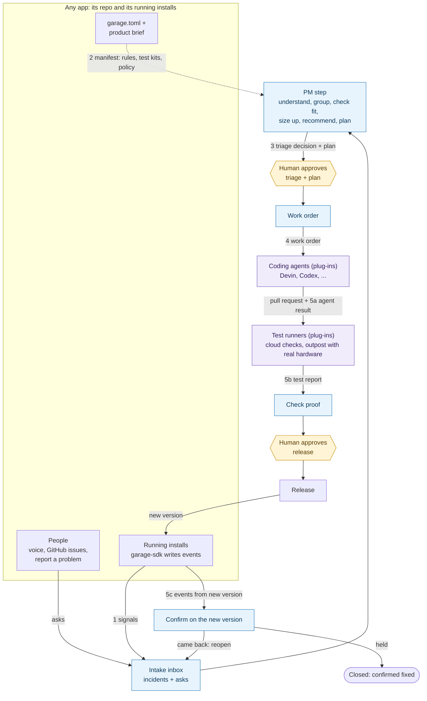

# Garage interface v0 (draft spec)

Status: **draft for review**. This describes the intended loop, not a promise of current behavior.
Adapted from ambient-home's `docs/factory-interface-v0.md` on origin/main.
Garage already implements local signals, manifests, reporting and Devin dispatch; section 6 separates those
from the proposed contracts below. All normative requirements below are proposals unless listed as implemented.

## 1. What Garage is

Three kinds of tools already exist around a running app:

| Tool | Takes you from | Examples |
|---|---|---|
| Observability | running app → signals (logs, traces, errors) | OpenTelemetry, Sentry, Datadog |
| Coding agents | a task → a pull request | Devin, Codex, Copilot cloud agent |
| CI/CD | code → a release | GitHub Actions, release scripts |

Nothing standard owns the full way back:

```
signals → a good task → an agent → proof it works → release → confirmed fixed in the real world
```

Today a person does that by hand: reads the crash, writes the ticket, picks the agent,
tests the fix (sometimes on real hardware), ships it, and watches whether the problem stopped.

**Garage is that missing middle: a control loop between a running app and coding agents.**
It keeps comparing "what should be true" (no open incidents, approved features done) with
"what is happening" (the app's events), and sends out work until the two match.

It is not "fix everything that comes in". Between intake and fixing sits a **product manager
(PM) step**: look at all incoming problems and requests together, work out the real need,
decide what is worth doing and in what order, and propose how to do it. A human approves
those decisions before any code is written.

```
intake → triage → plan → approve → build → test → release → confirm
  ^       (PM)    (PM)   (human)                              |
  +------------------- reopen if it comes back --------------+
```

Intake has two streams that meet in one inbox:
- **signals**: events from running installs, grouped into incidents by detection rules;
- **asks**: feature requests, enhancements and bug reports from people (voice, GitHub issues,
  "report a problem").

### Conceptual diagram

Blue boxes are Garage, purple boxes are plug-ins, and yellow hexagons are the
points where a human must approve. The numbers on the arrows are the contracts in section 2.



Some vendors cover parts of this (checked 2026-10, from their public docs):
- Sentry Seer Autofix can go from a Sentry issue to a drafted PR.
- Datadog Bits Code turns Datadog signals into fix PRs.
- GitHub lets you assign an issue to the Copilot cloud agent, which opens a PR.

Each is tied to its own vendor's signals or agent, and each stops at the PR. None of them
(as far as their docs say) picks between agents, requires a specific test kit such as a
hardware test, or checks after release that the problem actually stopped. None of them does
product triage either: deciding across many asks what to build, what to merge together, and what
to turn down. Garage aims to be the vendor-neutral loop that uses these tools as plug-ins rather
than replacing them.

### Words used here

- **App**: any program Garage looks after (ambient-home is the first).
- **Install**: one copy of an app running on one machine.
- **Event**: one line the app writes about something that happened.
- **Incident**: a problem Garage found by grouping events (e.g. "mic silent 3 times in 6 h").
- **Request**: a feature or fix someone asked for (by voice, issue, or "report a problem").
- **Ask**: anything a person asked for: a feature, an enhancement, a bug report, an idea.
- **Intake item**: one incident or ask waiting in Garage's inbox.
- **Triage**: deciding what an intake item really is, whether it is worth doing, and how urgent it is.
- **Plan**: a short proposal of how to do an accepted item, written before any code.
- **HITL** (human in the loop): a step where a person must approve before Garage moves on.
- **Product brief**: a file in the app's repo that says what the product is for, who it is for,
  and what it will not do. The PM step judges asks against it.
- **Work order**: the task packet Garage hands to a coding agent.
- **Test kit**: the app's own check command that proves a change works (e.g. `ambient-hw-test`).
- **Outpost**: a machine with special hardware where a test kit must run (e.g. the Mac with the robot).
- **Connector**: a small plug-in that lets Garage talk to one outside system (GitHub, Devin, Sentry...).

## 2. The five contracts

An app plugs into Garage by meeting five contracts. Garage never imports app code.

| # | Contract | Direction | Who writes it |
|---|---|---|---|
| 1 | Signals | app → Garage | the app, using `garage-sdk` |
| 2 | Manifest (`garage.toml`) + product brief | app → Garage | the app's repo, once |
| 3 | Triage decision + plan | PM step → human → Garage | the PM step proposes, a human approves |
| 4 | Work order | Garage → agent | Garage, from an approved plan |
| 5 | Proof | agent / test kit / app → Garage | test kit output, then new events |

### Contract 1: Signals (events)

Every event is one JSON object per line. The shape is a small subset of the
[OpenTelemetry logs data model](https://opentelemetry.io/docs/specs/otel/logs/data-model/),
with a future OTLP transport proposed. Today Garage reads local JSONL only.

```json
{
  "ts": "2026-10-26T13:24:05.120Z",
  "type": "mic.silent_stream",
  "component": "audio",
  "level": "error",
  "resource": {"app": "ambient-home", "version": "0.2.0+8bc8ef5", "install": "a1b2c3d4"},
  "data": {"device": "reachy", "seconds": 12.5}
}
```

| Field | Required | Meaning | OpenTelemetry field |
|---|---|---|---|
| `ts` | yes | UTC time, timezone-aware | `Timestamp` |
| `type` | yes | dotted event name, stable over time | `EventName` |
| `component` | yes | part of the app that emitted it | `InstrumentationScope.name` |
| `level` | yes | `info` / `warning` / `error` | `SeverityText` |
| `resource.app` | yes | app id, same as in `garage.toml` | `service.name` |
| `resource.version` | yes | exact running version (see below) | `service.version` |
| `resource.install` | yes | random id per install, not tied to a person | `service.instance.id` |
| `data` | no | flat key → string/number/bool/null | `Attributes` |

Rules:
- **Scrubbed before writing.** Secrets, tokens, emails, home paths and free text from users are
  removed or masked by the SDK, not by Garage. Anything in the log may end up in a public issue.
- **Local by default.** Events go to a day-partitioned JSONL folder on the install's own machine,
  kept for a limited time (ambient-home: 14 days). Nothing is sent anywhere unless the user opts in.
- **Version on every event**, so Garage can tell "before the fix" from "after the fix".
  Format: the package version plus the short git commit, e.g. `0.2.0+8bc8ef5`.

Proposed standard event types every app should emit (automatic helpers and confirmation are not implemented):

| Type | When | Needed `data` |
|---|---|---|
| `app.started` | process start | — |
| `app.heartbeat` | every N minutes while healthy | `uptime_s` |
| `app.stopped` | clean exit | `exit_code` |
| `app.crashed` | uncaught exception | `exc_type`, `where` (module:function) |
| `request.made` | a user asked for a feature or fix | `summary` (scrubbed), `source` |

Heartbeats matter for **confirm**: "no incident since the release" only means something if
the new version was actually running.

Everything else (`mic.silent_stream`, `live.api_error`, `tool.completed`...) is app-specific
and is only given meaning by the app's detection rules in the manifest.

### Contract 2: Manifest (`garage.toml`)

One file at the root of the app's repo. It tells Garage everything app-specific, so the
Garage code stays generic. This is a proposed extended manifest, not a runnable current configuration.
Use `examples/ambient-home/garage.toml` for today's schema. Example for ambient-home:

```toml
[app]
id = "ambient-home"
repo = "github.com/sesh11/ambient-home"

[product]
brief = "docs/product.md"             # purpose, users, principles, non-goals, current focus

[intake]
asks = ["github:issues", "voice", "report-a-problem"]

[triage]
cadence = "daily"                     # when the PM step reviews the inbox and sends a digest
auto_accept = ["incident:critical"]   # may skip the triage approval (still needs plan approval)

[build]
setup = "uv sync"
check = ["uv run ruff check .", "uv run mypy", "uv run pytest tests/ -q"]

[signals]
source = "jsonl"                      # or "otlp", "sentry"
path = "~/.ambient-home/telemetry"    # per-install folder

[detect]
rules = "rules.toml"                  # app-owned detection rules

[[test_kit]]
name = "robot"
command = "ambient-reachy-hw-test --json report.json"
runs_on = "outpost:my-mac"            # needs the real robot
when = "always"                       # or a list of paths, e.g. ["src/ambient_home/audio/**"]
max_minutes = 3
costs_money = false

[release]
command = "scripts/build-release.sh"  # issue #30
version_from = "pyproject.toml"

[confirm]
quiet_for = "24h"                     # incident must not recur on the new version for this long
min_heartbeats = 12                   # and the new version must really have run

[policy]
agents = ["devin", "codex"]           # in order of preference
max_concurrent = 1
needs_approval = ["triage", "plan", "release"]   # HITL steps
```

### Contract 3: Triage decision and plan (the PM step)

This is where Garage behaves like a good product manager instead of a ticket queue.
The PM step is run by an agent (any agent connector), but its output is only a **proposal**.
A human makes the decision.

**What the PM step does**, looking at the whole inbox, not one item at a time:
1. **Understand.** Restate each item as the underlying need. "Make Alfred louder" may really be
   "I can't hear him from the kitchen", which could be volume, a second speaker, or a new device.
2. **Group.** Merge duplicates. Link related items, e.g. three asks plus one incident that all
   come down to the mic. Many small asks often add up to one better feature.
3. **Check fit.** Compare against the product brief. Does it fit what the product is for? Does it
   belong in the core, a device connector, or nowhere? Is it a non-goal?
4. **Size it up.** Impact (how many people or installs, how often, how bad), rough effort and
   agent cost, risk (e.g. touches the mic, the robot, money or privacy), and what it depends on.
5. **Recommend.** One of: `do-now`, `plan`, `backlog`, `needs-info` (with the exact question to
   ask), or `decline` (with a reason, posted politely on the issue).
6. **Plan** accepted items: two or three options, the recommended one and why, what is in and out of
   scope, acceptance criteria (how we will know it worked), which test kits must pass, and whether
   it needs a hardware test.

**Triage decision** (one per intake item or group):

```json
{
  "items": ["#41", "#44", "incident:mic_silent_stream:3f9a1c20aa"],
  "need": "Alfred stops hearing me after the Mac wakes from sleep",
  "kind": "bug",
  "fit": "core",
  "impact": "high", "effort": "small", "risk": "medium",
  "recommendation": "do-now",
  "reason": "Same root cause behind two asks and one incident; blocks every other feature."
}
```

**Plan** (posted on the issue for accepted items):

```json
{
  "options": ["restart audio stream on wake", "reboot XMOS on silence", "both"],
  "chosen": "restart audio stream on wake",
  "why": "smallest change that matches the evidence; XMOS reboot already exists as a fallback",
  "scope_out": ["changing the mic hardware"],
  "acceptance": ["no mic.silent_stream on the new version for 24h", "robot test passes"],
  "must_pass": ["build.check", "test_kit:robot"]
}
```

**Human approval points (HITL):**
- **Triage:** the human accepts, edits or overrides the recommendations, normally from a short
  digest (daily or weekly, set by `triage.cadence`). Policy may let urgent incidents skip this
  step (`triage.auto_accept`).
- **Plan:** the human approves one plan before a work order is sent. This is never skipped.
- **Release:** see contract 5.

Approvals are a label or a short comment on the issue (e.g. `/approve`, `/decline <reason>`), so
they work from a phone. Every human decision is kept with the issue. The PM step reads past
decisions on its next run, so its recommendations get closer to the maintainer's judgment over time.

**Rationalizing over time.** Besides triaging new items, the PM step regularly looks back across
the backlog: it proposes themes, retires stale asks, and suggests what to focus on next. Those
suggestions are proposals to update the product brief's "current focus", which the human approves.

### Contract 4: Work order

What Garage hands to a coding agent, built only from an approved plan. It is agent-neutral JSON; each agent connector turns
it into that agent's prompt or task format (a Devin session, a Codex task, a GitHub issue
assigned to Copilot...).

```json
{
  "id": "wo-ambient-home-42-1",
  "app": "ambient-home",
  "repo": "github.com/sesh11/ambient-home",
  "kind": "incident",
  "issue": "https://github.com/sesh11/ambient-home/issues/42",
  "title": "Microphone stream silent while running",
  "fingerprint": "mic_silent_stream:3f9a1c20aa",
  "seen_in_version": "0.2.0+8bc8ef5",
  "evidence": [ {"ts": "...", "type": "mic.silent_stream", "data": {"seconds": 12.5}} ],
  "goal": "The mic keeps delivering audio; no mic.silent_stream events on the new version.",
  "must_pass": ["build.check", "test_kit:robot"],
  "constraints": {"base_branch": "main", "never_merge": true, "max_cost": "policy default"},
  "plan": "https://github.com/sesh11/ambient-home/issues/42#issuecomment-...",
  "report_back": "contract 5 agent result"
}
```

- `kind` is `incident` or `request`. A request has the approved need and plan instead of
  `evidence`. The agent builds what the plan says; if it finds the plan is wrong, it stops and
  reports back instead of improvising.
- `evidence` is copied from scrubbed events only.
- `must_pass` comes from the manifest and the plan: Garage, not the agent, decides which test kits count.

### Contract 5: Proof

Proof comes back in three stages. An issue closes only after all three.

**5a. Agent result** (proposed generalization of `OUTPUT_SCHEMA` in
`src/garage/dispatch.py`):

```json
{"work_order": "wo-ambient-home-42-1", "summary": "...", "pr_url": "https://...", "risk": "low"}
```

**5b. Test-kit report** (proposed required-version form of the SDK's `TestReport`):

```json
{"ok": true, "run_id": "...", "version": "0.2.0+1a2b3c4", "seconds": 118.0,
 "checks": [{"name": "mic", "status": "pass", "seconds": 70.2, "detail": "..."}]}
```

Exit codes: `0` pass, `1` fail, `2` could not run (e.g. robot unplugged). "Could not run" is
never treated as a pass.

**5c. Confirmation** (computed by Garage from contract 1 events, after release):
- events with the new `resource.version` exist, with at least `min_heartbeats` heartbeats, and
- the incident's rule did not fire on the new version for `quiet_for`.

If both hold, the issue closes as confirmed. If the incident fires again on the new version,
the issue reopens with the new evidence. For asks, confirmation is the plan's acceptance criteria,
and the person who asked gets a note on the issue that it shipped.

Release itself is a HITL step in v0: a human approves after reviewing 5a and 5b.

## 3. The issue lifecycle

The tracker (GitHub issues today) is where people see the loop. Current `factory:observed`, `factory:ready-for-fix`, `factory:dispatched` and `factory:fixing`
labels are kept; the proposal adds triage and release labels. See the README for today's exact transitions.

```
new ask / factory:observed incident
    → factory:triage                       (PM step recommends; human decides)
        ↘ factory:needs-info  ↘ factory:backlog  ↘ closed as declined (with reason)
    → factory:planning → factory:ready-for-fix   (plan approved = ready)
    → factory:dispatched / factory:fixing
    → factory:testing → factory:released → closed (confirmed)
                                         ↘ reopened (came back on new version)
```

Today bridge requests skip straight to `factory:ready-for-fix` with `factory:request`. Under this spec they go through
triage and plan approval like any other ask.

## 4. What goes where

This section is the target allocation, including unimplemented pieces. Source paths refer to Garage now;
the app integration bullets describe what an app should provide, not verified ambient-home deployment status.

### `garage-sdk` (small library every app installs)

Kept tiny and low-dependency, because every app and every end-user install pulls it in.

- `Event` model and `EventLog` writer (`packages/garage-sdk/src/garage_sdk/events.py`)
- scrubbing (`packages/garage-sdk/src/garage_sdk/scrub.py`)
- version stamp and install id
- standard event helpers (`app.started`, heartbeat, crash hook, `request.made`)
- test-kit report helper (write contract 5b JSON + exit codes)
- schemas for `garage.toml`, triage decisions, plans, work orders and proof, so apps and
  Garage agree on one copy
- later: opt-in "report a problem", which turns local events into a scrubbed issue on the app's repo

The SDK never talks to an agent or a tracker by itself.

### Garage (the loop)

Runs wherever the app's maintainer runs it (for ambient-home: Nithin's Mac, reading his
install's log). Not installed by end users.

- loop: intake → triage → plan → approve → build → test → release → confirm
- detectors (`src/garage/incidents/`)
- the PM step: inbox, grouping, triage digest, plans, approval handling, record of past decisions
- connectors, each behind a small interface:
  - **sources**: local JSONL, OTLP, Sentry
  - **trackers**: GitHub (`src/garage/github.py`), later Linear
  - **agents**: Devin (`src/garage/agents/devin.py`), later Codex
  - **test runners**: cloud VM, outpost
- reads each app's `garage.toml`; no app-specific code inside

### The app (ambient-home)

- uses `garage-sdk` to write events and its test-kit report
- ships `garage.toml`, its detection rules, and its product brief (`docs/product.md`)
- keeps its own voice-job Devin client for "Alfred, do X" jobs; that is a product feature,
  separate from Garage fix sessions

## 5. End-user installs

End users run the app and the SDK only. Their events stay on their machine. If something
breaks, they report it: today by opening an issue by hand, later with the SDK's opt-in
"report a problem" that files a scrubbed issue in the same shape as an incident. Feature asks
from users arrive the same way, as issues. Both land in the maintainer's inbox and go through
triage like everything else. There is no hidden telemetry.

## 6. Gaps in today's code

Implementation references are relative to this Garage repository.

| Contract | Implemented today | Still missing |
|---|---|---|
| 1 Signals | `packages/garage-sdk/src/garage_sdk/events.py`: scrubbed, day-partitioned JSONL; optional resource stamps; `resource.py`: version and install-ID helpers; legacy unstamped events supported | automatic standard event helpers, OTLP transport, mandatory version stamps, version-aware confirmation |
| 2 Manifest | `garage_sdk/manifest.py` (under the SDK source): app, build, signals, detect, report, dispatch, test kits and policy; top-level `product_brief` path; `src/garage/settings.py` resolves manifest-relative paths | product brief review, intake/triage/release/confirm sections and their execution |
| 3 Triage + plan | incident thresholds mark issues ready; bridge requests are filed ready; policy validates human plan/release requirements and rejects auto-release | actual triage, plans, approval gates and digest; `policy.auto_accept` is parsed but ignored |
| 4 Work order | `src/garage/dispatch.py`: manifest-driven Devin prompts, build checks and test-kit instructions, configurable base branch, duplicate ledger; `agents/devin.py` sends a per-session ACU limit | agent-neutral work orders tied to approved plans, enforced test requirements, other agents |
| 5 Proof | dispatch structured output and outcome comments; SDK `report.py` supplies test-report models, optional version, read/write and exit-code helpers | a test runner, independent proof validation, release/deploy, heartbeat confirmation and confirmed closure |

Garage also has a local incidents UI and a loopback request bridge. GitHub reporting deduplicates incidents by
fingerprint, caps new incidents and requests separately per day, and can reopen closed incidents from newer samples.
This is not confirmation on a released version. Dispatch adds both dispatched and fixing labels without removing
ready; follow-up removes fixing only. Reopening an incident does not clear dispatched.
See [the README](../README.md) for exact label paths, configuration and bridge security rules.

The SDK and service are separate distributions in this repository. JSONL is the only implemented source, GitHub
the tracker and Devin the agent. Multi-repository onboarding, GitHub sign-in, hosted deployment and hosted CI
are not implemented. Local Ruff, mypy and pytest checks exist.
Test kits only supply prompt text: even the example robot kit is not executed or hardware-verified by Garage.

## 7. Open questions

1. When should OTLP or other signal sources be added alongside local JSONL?
2. Who approves release: always a human (the current schema requires it), or a future explicit low-risk policy?
3. What cadence should triage use: daily digest, weekly, or per-item?
4. Can critical incidents skip triage approval while still requiring plan approval?
5. Who authors and approves each app's product brief?
6. What evidence must a test runner validate before permitting release?

Naming and packaging are settled for this draft: Garage is the service, `garage-sdk` is the independent SDK
distribution in `packages/garage-sdk`, and apps configure `garage.toml`. Existing `factory:*` labels,
`factory.*` event types and issue markers remain unchanged for compatibility.

## 8. Next steps (after this spec is agreed)

1. Adopt optional resource stamps in apps and add standard lifecycle/heartbeat helpers.
2. Complete product briefs and extend the manifest schema for the proposed workflow.
3. Implement triage, plans and explicit human approval before dispatch; route bridge requests through them.
4. Add test-runner connectors and proof validation, including isolated hardware tests when required.
5. Add human-approved release and version-aware confirmation, with testing/released labels and recurrence handling.
