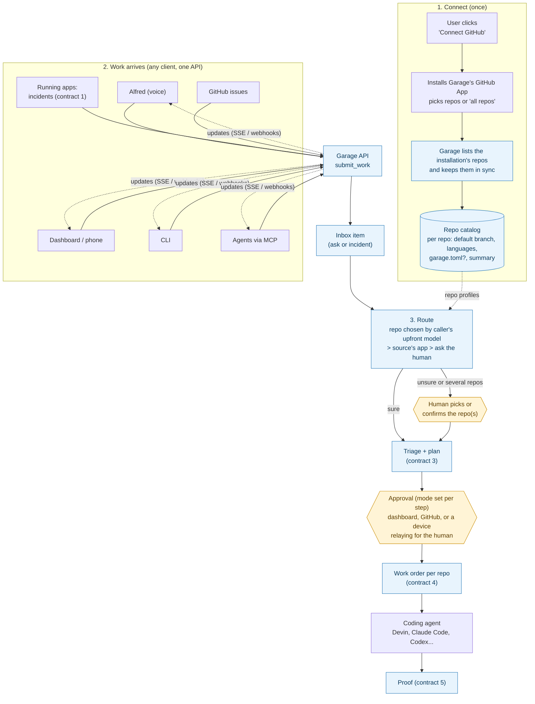

# Personal garage: connecting GitHub, knowing every repo, routing work, one interface

Status: **design draft for review. No code yet.** Builds on [vision.md](vision.md) (contracts 1–5).

## Decisions so far (from Nithin)

1. **Mac first, hosted later.** Garage runs on the user's own machine; a hosted version comes later.
2. **Open source from day one.** Another developer must be able to download Garage and use it on their
   own repos with no help from us (§3a).
3. **The "upfront model" picks the repo.** Whatever assistant or agent the person is talking to (Alfred,
   Claude Code, Codex, Devin...) already has an AI model. Garage gives it the repo catalog and lets
   it choose; Garage itself does not call an LLM to route (§4).
4. **Approvals are configurable.** Whoever connects to Garage sets up how approvals work, with a few
   modes. A device relaying approval (Alfred saying "approve") is one of those modes (§5a).

## 1. The idea in one paragraph

Each person (or team) gets their **own garage**. They connect their code host once (GitHub first).
From then on Garage knows every repo they gave it, and anyone (the person, their voice assistant,
their phone, another coding agent) can hand it work: "make the wake word less sensitive", or an
incident from a running app. Garage works out which repo(s) the work belongs to, asks the human when
it isn't sure, gets approval, and sends a work order to a coding agent. Every client talks to Garage
through **one API** with the same nouns and verbs, so the dashboard, Alfred, a CLI and an agent see
the same thing.

### Words used here

- **Workspace**: one person's or team's garage: their connections, repos, inbox and history.
- **Connection**: a link to an outside service (GitHub, Devin, Linear, ...) with its credentials.
- **GitHub App**: a kind of GitHub integration that a user *installs* on chosen repos. It acts as
  its own bot account (not as the user) and GitHub can push events to it ("webhooks").
- **Installation**: one install of the GitHub App on a user or org account, covering some or all repos.
- **Webhook**: GitHub calling a URL of ours when something happens (repo added, issue opened).
- **Repo catalog**: Garage's list of repos it can reach, with a short profile of each.
- **Routing**: picking which repo(s) a piece of incoming work belongs to.
- **Client**: anything that calls Garage: dashboard, Alfred, CLI, phone, an agent.
- **MCP** (Model Context Protocol): a standard way for AI agents (Claude Code, Codex, Devin...) to
  call tools. Garage would expose its verbs as MCP tools.
- **SSE** (server-sent events): a simple way for a web page or client to receive live updates over HTTP.
- **Upfront model**: the AI model inside whatever the person is talking to (Alfred's voice model, a
  Claude Code session, ...). It understands the ask; Garage keeps the records and the rules.
- **Approver**: a person, or a device/assistant acting for a person, allowed to say yes or no at an
  approval step.

## 2. The whole flow



Routing is just a new first part of the existing triage step, so the human approves the repo choice at
the same moment they approve the triage decision. No extra approval stop unless Garage is unsure.

## 3. Connecting GitHub and knowing every repo

### Recommendation: a GitHub App, not a personal token

| | Personal token (today) | GitHub App (proposed) |
|---|---|---|
| Who the actions look like | the user | a bot, e.g. `garage[bot]` |
| Which repos | everything the user can touch | only repos the user picked at install |
| Expiry | long-lived secret | short-lived tokens (1 h) minted on demand |
| Learning about changes | Garage has to poll | GitHub sends webhooks (or Garage polls, see below) |
| Multi-user product | each user pastes a secret | each user clicks "Install" |

### The install flow

1. The user runs `garage init` (or clicks "Connect GitHub" on the dashboard).
2. **Getting an App at all.** Two options:
   - *Shared app* (hosted product later): one "Garage" App that everyone installs.
   - *Own app* (local-first, now): Garage registers a private App for this user in one click using
     GitHub's **App manifest flow** (Garage sends a prefilled form; GitHub hands back the App id,
     private key and webhook secret). Nothing is shared between users, no server of ours is needed.
   **Decided: own app via the manifest flow.** It needs no hosted service and no shared secret, which
   is also what lets anyone run Garage from the open source repo (§3a).
3. The user is sent to the App's install page and chooses **"All repositories"** or **"Only select
   repositories"**. GitHub then redirects back to Garage's *setup URL* with the `installation_id`.
4. Garage stores a **Connection** (`kind=github`, installation id, account login) in its local state;
   the App's private key goes in the OS keychain or a `0600` file, never in `garage.toml`.
5. Garage does a first full sync of repos (below), then shows the catalog: "I can see 14 repos; 2 have
   a `garage.toml`."

Many installations can exist in one workspace (e.g. personal account + an org).

### Keeping the repo list in sync

- **Full list**: `GET /installation/repositories` with the installation token (paged).
- **Changes**: the `installation` webhook (installed / deleted / suspended) and the
  `installation_repositories` webhook (repos `added` / `removed`).
- **Safety net**: a full re-list on start and every few hours, because webhooks can be missed.
  Removing a repo from the App makes Garage mark it `unreachable`, not delete its history.

### What Garage stores per repo (the repo profile)

| Field | Where it comes from | Used for |
|---|---|---|
| `full_name`, `id`, `private`, `archived` | installation repo list | identity; archived repos are never routed to |
| `default_branch` | repo API | default `base_branch` for work orders |
| `languages` | `GET /repos/{o}/{r}/languages` | routing hint, agent choice |
| `topics`, `description` | repo API | routing hint |
| `has_manifest` + parsed `garage.toml` | contents API, root `garage.toml` | app id → repo, test kits, policy |
| `summary` (2–4 sentences) | README + manifest `product_brief`, summarized once by an LLM, refreshed on push to default branch | routing |
| `keywords` | summary + top-level dirs + package names | cheap routing without an LLM |
| `last_synced_at`, `status` (`ok`/`unreachable`) | Garage | freshness |

Repos without a `garage.toml` are still in the catalog and can receive asks; they just get default
policy (always ask the human, no test kits). Adding a `garage.toml` makes a repo "fully managed".

### Running on a Mac with no public URL

GitHub can only push a webhook to a URL it can reach. Options:

| Option | How | Good | Bad |
|---|---|---|---|
| **A. Polling** | Re-list repos and read issues every few minutes (Garage already polls issues) | nothing to set up, works offline-ish | slower (minutes), uses API rate limit |
| B. Poll GitHub's delivery log | GitHub keeps a log of App webhook deliveries; Garage reads it with the App's key | real event payloads, no public URL | needs checking that failed deliveries are kept and fetchable (see §8) |
| C. Relay (smee.io-style or our own) | a public relay receives webhooks; Garage holds an outbound connection to it | near-instant | another service to trust; payloads pass through it |
| D. Tunnel (Cloudflare Tunnel, ngrok, Tailscale Funnel) | exposes the Mac's port publicly | instant | user must install and keep a tunnel; exposes the Mac |

**Recommend A now** (fits "Mac first"), with the webhook handler written so B or C can feed it later without changes
(everything goes through one `handle_github_event(name, payload)` function). Repo lists change rarely,
so minutes of delay don't matter. When there's a hosted Garage, it receives webhooks directly.

## 3a. Open source from day one: what that changes

Another developer should be able to go from `git clone` (or `uvx garage` / `pipx install garage`) to a
working garage on their own repos. That means:

- **No shared secrets or servers of ours.** Each user creates their own GitHub App through the manifest
  flow (§3); their keys stay on their machine. Agent keys (Devin, OpenAI, Anthropic...) are theirs too.
- **`garage init`** does the whole setup interactively: create the GitHub App, install it on chosen repos,
  sync the catalog, register a first client (the dashboard), pick approval modes (§5a), and optionally
  connect an agent. It writes a workspace config file (no secrets) plus keychain/`0600` secrets.
- **Nothing specific to us in the code.** The existing boundary test already bans app words; ambient-home
  becomes one example under `examples/`, not a requirement.
- **Works with zero agents connected**: you can still connect GitHub, see the catalog, and file asks;
  dispatch is off until an agent is connected (today's "default off" safety rule).
- **Publishing basics**: a LICENSE (decision below), versioned releases of `garage` and `garage-sdk`
  on PyPI, a quickstart in the README, and the `/v1` API + JSON Schemas documented as the stable
  surface other people build clients against.
- **Hosted CI on the public repo** (GitHub Actions running the existing gate), so outside contributors'
  PRs get checked. Today there is none.

## 4. Routing incoming work to the right repo

**Decided: the upfront model routes.** Garage doesn't run its own LLM to guess repos. Instead it gives
callers what they need to choose well, checks the choice, and falls back to the human. This keeps
Garage free of model keys and model costs, and the caller usually knows more about the ask anyway
(Alfred heard the whole conversation; a Claude Code session is already inside a repo).

What Garage provides for this:
- `GET /v1/repos` / MCP `garage_repos`: the catalog with each repo's profile (description, topics,
  languages, README excerpt, `garage.toml` app id and related repos). The README excerpt is used as the
  summary, with no LLM.
- An MCP **prompt/instructions** text shipped with the MCP server telling the upfront model: "pick repo(s)
  from `garage_repos`; give a confidence and one-line reason; if unsure, leave `repo` empty."
- Optional cheap keyword ranking (no LLM) for callers with no model of their own (a plain CLI, a webhook).

Garage then applies these rules, in order:

Run these in order; stop at the first that gives a confident answer.

1. **Explicit**: the caller names the repo(s) (`repo: "sesh11/ambient-home"`). Trusted callers win;
   Garage only checks the repo is in the catalog.
2. **The source's own app**: an incident or "report a problem" carries `app_id` (from the event's
   resource stamp) → the catalog repo whose `garage.toml` has that `[app] id`. A GitHub issue already
   belongs to a repo. A client can also have a **default repo** set when it was registered (Alfred →
   ambient-home).
3. **The caller's pick** (from its upfront model), with its confidence and reason. Garage checks the repo
   exists in the catalog and isn't archived. A public/untrusted source's pick is never taken as final.
4. **Ask the human**: if no repo was given, the caller's confidence is below a threshold (start at 0.8),
   or the trust level of the caller is low,
   the inbox item goes to `needs_repo` with the top 3 choices. The human taps one (works from a phone,
   or Alfred asks "Is that for ambient-home or ambient-devices?").

Every human answer is stored with the ask text and returned in `garage_repos` as "past examples", so the
upfront model's next pick gets better without Garage running a model.

Explicit-repo (1) and the caller's pick (3) are listed separately because they carry different weight:
an explicit repo from an `owner` is final; a model's guess still goes through the confidence check.

### Asks that span several repos

"Make the wake word less sensitive" may need a change in the core (ambient-home) **and** a device
connector (ambient-devices). Proposal:

- The routing result is a **list** of repos, each with a role (`primary`, `also`).
- The plan (contract 3) says what changes in each repo and in which order.
- On approval Garage creates **one work order per repo**, linked by a shared `parent` id. The agent for
  the second repo gets the first PR's link. Proof (contract 5) closes the ask only when all children pass.
- A `garage.toml` may declare related repos (`[app] related = ["sesh11/ambient-devices"]`) to make this
  routing cheap and reliable.

### Routing decision (new, part of contract 3)

```json
{
  "item": "ask:7f3c",
  "repos": [
    {"repo": "sesh11/ambient-home", "role": "primary", "confidence": 0.86,
     "reason": "wake-word threshold lives in the core's settings"},
    {"repo": "sesh11/ambient-devices", "role": "also", "confidence": 0.41,
     "reason": "mic gain is set by the device connector"}
  ],
  "method": "caller_model",
  "needs_confirmation": true
}
```

## 5. One interface for every client

### The nouns

| Noun | What it is |
|---|---|
| **Workspace** | one person's garage; everything below belongs to one |
| **Connection** | GitHub install, Devin org, Claude Code on this Mac, ... (no secrets ever returned) |
| **Repo** | a catalog entry (§3) |
| **Client** | a registered caller (dashboard, Alfred, CLI, an agent) with its token and trust level |
| **Inbox item** | one ask or incident; has a state (below) |
| **Routing decision** | §4 |
| **Triage decision**, **Plan** | contract 3 |
| **Approval** | a human's yes / no / edit / answer on a triage, plan, repo choice or release |
| **Work order** | contract 4, one per repo |
| **Run** | one attempt by one agent on one work order (today: a Devin session) |
| **Proof** | contract 5 (agent result, test report, confirmation) |
| **Event** | "something changed" record that drives live updates |

Inbox item states: `new → routing → needs_repo → triage → needs_info → planning → awaiting_approval →
approved → running → testing → done | declined`. These map onto the existing `factory:*` labels (§6).

### The verbs

| Verb | HTTP | MCP tool | Who may call |
|---|---|---|---|
| submit work | `POST /v1/items` | `garage_submit` | apps, humans, agents |
| list / get items | `GET /v1/items`, `GET /v1/items/{id}` | `garage_list`, `garage_get` | all |
| answer a question (pick repo, needs-info) | `POST /v1/items/{id}/answers` | `garage_answer` | humans; agents only if allowed |
| list waiting approvals | `GET /v1/approvals` | `garage_pending_approvals` | all (filtered) |
| approve / decline / edit | `POST /v1/approvals/{id}/decision` | `garage_decide` | whoever the step's mode allows (§5a) |
| cancel | `POST /v1/items/{id}/cancel` | `garage_cancel` | the submitter or a human |
| list repos | `GET /v1/repos` | `garage_repos` | all |
| connections | `GET /v1/connections`, `POST /v1/connections/github/start` | — | humans (owner) |
| clients and tokens | `POST /v1/clients` | — | humans (owner) |
| subscribe | `GET /v1/events` (SSE); later outgoing webhooks | MCP notifications | all, filtered to what they may see |

`submit` is safe to retry: the caller sends an idempotency key (today's request `id` already does this).

Example submit, the same from Alfred, the CLI or Claude Code:

```json
POST /v1/items
{
  "id": "alfred-2026-11-01-0007",
  "kind": "ask",
  "text": "Make the wake word less sensitive",
  "repo": null,
  "source": {"client": "alfred", "app_id": "ambient-home", "channel": "voice"},
  "context": {"heard_at": "2026-11-01T14:10:00Z"}
}
→ 202 {"item": {"id": "ask:7f3c", "state": "routing", "url": "http://localhost:8765/items/ask:7f3c"}}
```

### Who is calling and what they may do

Each client is registered once and gets its own token (`garage client add alfred --kind app`).
Garage records which client did every action (the audit log).

| Kind | Examples | May | May not |
|---|---|---|---|
| `owner` | Nithin on the dashboard or phone | everything | — |
| `app` | Alfred, a running install | submit, read own items, answer | approve, unless a mode in §5a allows it |
| `agent` | Claude Code, Codex, Devin via MCP | submit, read, attach findings | approve (unless allowed in §5a), change connections |
| `public` | text from a GitHub issue by a stranger | becomes an inbox item | skip triage; its text is treated as untrusted data, never as instructions |

- Who may approve is not fixed by kind; it is set by the approval modes in §5a. By default only `owner`
  can approve.
- **Trust level** of an ask (`owner` > `app` > `agent` > `public`) decides how much Garage does on its
  own: e.g. owner asks may skip the triage digest; public asks always wait for triage. Untrusted text is
  quoted inside work orders, clearly marked, so it cannot instruct the agent (prompt injection).
- Locally, the API listens on loopback only (as the bridge does now); tokens are still required, so a
  random web page or another local program can't act as you.

## 5a. Approvals: one mechanism, several modes

An **approval request** is created whenever an item reaches an approval step: `repo` (confirm routing),
`triage`, `plan`, `release`. Garage then sends that request to the step's approvers and waits for an
**approval decision**. Every decision records who decided, through which client (`via`), and when.

Whoever sets up Garage (`garage init`, or the dashboard settings) picks a **mode per step**:

| Mode | What happens | Example |
|---|---|---|
| `manual` | only the owner, on the dashboard, the CLI or a GitHub comment (`/approve`, `/decline <reason>`) | the default for every step |
| `relay` | named clients may pass on the owner's decision; they must say it came from the person (`on_behalf_of`), and Garage records `via` | Alfred hears "approve the wake-word plan" and sends it |
| `delegate` | named clients may decide on their own, within limits (kinds, max cost, repos) | a trusted review agent approves triage of low-risk incidents |
| `auto` | Garage approves by itself when the policy rule matches | auto-accept triage for `critical` incidents |

Notes:
- **Asking is separate from deciding.** Every connected client can *be told* an approval is waiting
  (SSE, push, Alfred saying "the plan for the wake word is ready, shall I approve it?"). Only clients
  allowed by the mode can send back the decision.
- **Devices relaying approvals** are just `relay` mode on a device client. The device declares how it
  confirmed the person (e.g. `voice`, `button`), so the owner can allow voice for `triage` but not for
  `release`.
- **Safe defaults:** `manual` for every step after `garage init`. vision.md currently says plan approval is
  "never skipped" and auto-release is rejected; with this design those become defaults the owner can
  change, except that `auto` for `release` stays off until we have real proof checks (contract 5).
- Fits the manifest: `policy.needs_approval` and `policy.auto_accept` already exist in `garage.toml`. A
  repo's manifest can make a step *stricter* than the workspace setting, never looser.

Config sketch (workspace config, no secrets):

```toml
[approvals.repo]
mode = "relay"
clients = ["alfred", "dashboard"]

[approvals.triage]
mode = "auto"
when = "kind == 'incident' and severity == 'critical'"

[approvals.plan]
mode = "relay"
clients = ["alfred"]
confirmed_by = ["voice"]

[approvals.release]
mode = "manual"
```

API: `GET /v1/approvals?state=waiting`, `POST /v1/approvals/{id}/decision`
`{"decision": "approve" | "decline" | "edit", "reason": "...", "on_behalf_of": "owner", "confirmed_by": "voice"}`;
MCP `garage_pending_approvals`, `garage_decide`.

### What goes in `garage-sdk` vs the Garage service

Keep the SDK small and pydantic-only (as vision.md says).

**`garage-sdk` adds (new modules, nothing existing changes):**
- `garage_sdk.api`: pydantic models for the nouns and request/response bodies above
  (`SubmitWork`, `InboxItem`, `ItemState`, `RoutingDecision`, `ApprovalRequest`, `ApprovalDecision`,
  `ApprovalMode`, `WorkOrder`, `Run`, `RepoRef`,
  `GarageEvent`), plus their JSON Schemas exported as files so non-Python clients (the JS dashboard,
  a phone app) use the same shapes.
- Optional later: a thin typed client `garage_sdk.client` behind an extra (`garage-sdk[client]`, adds
  `httpx`), so the core SDK stays pydantic-only.

**Garage service:**
- the `/v1` HTTP API, SSE stream, auth, the MCP server (`garage mcp`, stdio for local agents, HTTP
  later), the repo catalog and sync, routing, the state store, GitHub App handling, agents.

**One shape everywhere**: the dashboard, the MCP tools and the CLI are thin layers over the same
service functions, and all use the SDK models, so there is exactly one definition of "an item".

### Where state lives

Garage's own state moves into one **SQLite** file (connections, catalog, items, decisions, runs, audit
log), replacing the JSON ledger over time. GitHub issues stay the human-facing view: every item that
gets past routing still has an issue in its repo with the same `factory:*` labels and markers, so
people who never open the dashboard can still follow and approve from GitHub.

## 6. Fit with contracts 1–5, the request bridge and labels

| Today | After | Migration |
|---|---|---|
| Contract 1 signals | unchanged; `app_id` in the resource stamp now also routes | none |
| Contract 2 `garage.toml` (one app = one repo) | still one app per manifest; manifests are *found* in catalog repos instead of passed on the command line; optional `related` repos | old single-manifest mode keeps working |
| Contract 3 triage + plan | gains the routing decision as step 0 | — |
| Contract 4 work order | gains `parent` and `repo` comes from routing; one per repo | field additions only |
| Contract 5 proof | parent closes when all child work orders have proof | — |
| `POST /api/requests` (Alfred) | becomes a thin alias of `POST /v1/items` with `kind=ask`, `repo=repository` | kept, same request and response, until ambient-home moves to `/v1` |
| `GET /api/requests/{number}`, `/fixing` | kept; also readable via `/v1/items` | — |
| single-repo `GitHubClient` with a token | one client per repo, built from an installation token | a personal token still works as a "token connection" for one repo |
| labels `factory:*`, markers `<!-- factory-... -->`, events `factory.*` | unchanged; new states add new `factory:*` labels (e.g. `factory:needs-repo`) | none |
| `CodingAgent` (Devin-shaped) | grows into start / status / message / cancel / result per work order | Devin adapter wraps the current client |

Nothing breaks for ambient-home: the SDK only gains new modules, the bridge endpoints stay, and labels
and markers don't change.

## 7. Build order (small phases, each usable on its own)

1. **SDK models + spec**: add `garage_sdk.api` models and JSON Schemas (new modules only, SDK minor
   bump to 0.2.0, no change to existing exports). Tests only.
2. **State store + `/v1/items`**: SQLite store, `POST/GET /v1/items`, client tokens, and the old
   `/api/requests` routed through it. Explicit repo only. ambient-home untouched.
3. **GitHub App connection + catalog**: manifest-flow App registration, install, repo sync by polling,
   repo profiles (no LLM summary yet), `GET /v1/repos`, dashboard "Connected repos" page.
4. **Routing + approvals**: app-id, default-repo and caller-pick routing, `needs_repo` with a pick-one
   answer; approval requests with `manual` and `relay` modes (then `delegate`, `auto`).
5. **Live updates + MCP**: SSE `/v1/events`, `garage mcp` (stdio) with submit/list/get/answer/decide
   tools and the routing instructions for upfront models.
6. **Multi-repo work orders**: parent/child work orders, linked PRs, joint proof.
7. **Open source release**: LICENSE, hosted CI, `garage init` end to end, PyPI releases, quickstart.
   (LICENSE and CI can land any time; the rest once phases 1–5 work.)
8. Later: webhook relay, hosted Garage, other trackers.

## 8. Verified vs assumed (vendor facts)

Checked against public docs on 2026-11-01:

- **Verified (GitHub docs)**: `GET /installation/repositories` lists repos an installation can reach;
  the installation object has `repository_selection` (`all` / `selected`); the `installation` and
  `installation_repositories` (`added` / `removed`) webhooks exist and all GitHub Apps receive
  `installation_repositories` by default; the App **manifest flow** exists (`POST
  /app-manifests/{code}/conversions` returns the new App's credentials); an App can turn webhooks off
  ("deselect Active"); installs can redirect to a *setup URL*; GitHub keeps a list of App webhook
  deliveries readable with the App's JWT (`List/Get/Redeliver a delivery for an app webhook`), and a
  single delivery includes the request headers and payload; GitHub's own docs suggest smee.io to forward
  webhooks to a local machine.
- **Verified (Claude Code docs)**: `claude -p` / `--print` runs non-interactively;
  `--output-format stream-json`; `--permission-mode` and `--allowedTools` control what it may do.
- **Verified (Codex docs)**: `codex exec "<task>"` runs non-interactively, prints the final message to
  stdout, and `--json` streams JSON Lines events.
- **Verified (MCP spec 2025-06-18)**: two standard transports, stdio and Streamable HTTP.
- **From Garage's own code, not re-checked against Devin docs**: Devin v3 sessions at
  `/v3/organizations/{org}/sessions` with repos, tags, structured output and an ACU limit.
- **Assumed, to verify before phase 3**: that deliveries which *failed* (unreachable URL) are kept in
  the delivery log and fetchable, which option B depends on; exact token lifetimes and rate limits for
  installation tokens; whether a personal account can register an App via the manifest flow without
  any public redirect URL (we expect `http://localhost` callbacks to work, untested).

## 9. Open questions

1. **License**: MIT (shortest, most permissive) or Apache-2.0 (permissive plus an explicit patent grant)?
   Recommend Apache-2.0 for a project others will build on.
2. **Is relayed voice approval OK for `plan` by default**, or should `garage init` default every step to
   `manual` and let the owner turn `relay` on? (The doc assumes all `manual`.)
3. Repos without a `garage.toml`: may they get work at all, or only after one is added?
4. Multi-repo asks: one combined plan approval, or one approval per repo?
5. Package name on PyPI: `garage` is likely taken; check and pick (e.g. `garage-loop`), keeping the
   `garage` command name.
